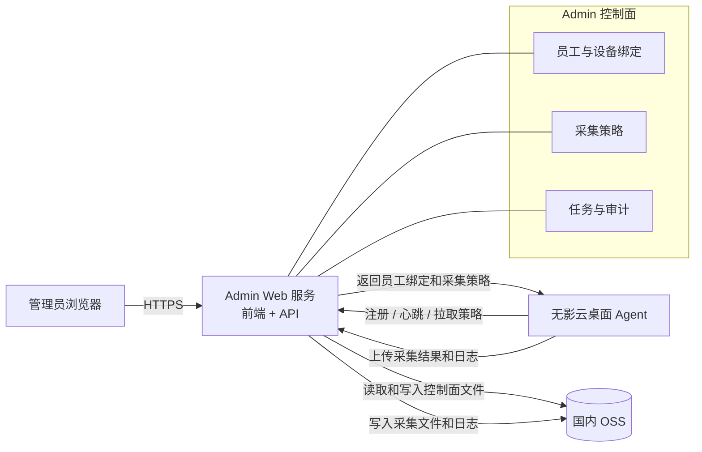

# 国内数据采集版（简化方案）

## 1. 目标

面向使用无影云桌面和 WorkBuddy 的国内客户。

客户自行购买和使用 WorkBuddy，我们只提供：

- 无影云桌面上的 Agent
- 设备与员工管理
- 数据采集、上传和删除
- 运行状态、日志和审计
- 简化版 Admin 后台

本版本不代理模型请求，不管理 API Key，不管理模型额度，不接入 LiteLLM。

## 2. 架构

```text
Admin Web 服务（前端 + API）
        │ HTTPS
        ├── 无影云桌面 Agent
        └── OSS：控制面记录、采集文件和日志
```

- Admin Web 服务同时提供前端页面和 API。
- Admin API 负责登录、权限、设备绑定、策略校验和 OSS 写入。
- Agent 只访问 Admin API，不携带 OSS AccessKey。
- 大文件由 Admin 服务端写入 OSS，或由 Admin 发放短时效、限定路径的上传地址。
- 只需要一台小型 Web 服务器，不需要独立数据库服务。

### 架构图



数据路径：

```text
管理员配置绑定和策略
        ↓
Admin Web 服务写入 OSS
        ↓
Agent 按 device_id 拉取策略
        ↓
Agent 上传采集结果和日志
        ↓
Admin Web 服务写入 OSS 并展示结果
```

## 3. Admin 保留和隐藏

### 保留

- 员工管理
- 设备注册、审批、绑定和解绑
- 采集策略和采集开关
- 设备状态和采集结果
- 日志、任务和审计
- Agent 发布和回滚
- 客户工单

### 隐藏或关闭

- LiteLLM 和模型渠道
- AWS、Azure、Google 凭据
- 模型目录、模型白名单和模型测试
- 云账单和供应商对账
- Codex 配置和凭据
- 软件安装与升级任务
- 多供应商路由和网关健康检查

后台仍然保留，前端只展示客户实际使用的菜单。国内版不提供软件安装和升级能力，相关菜单、API、任务类型和 Agent 执行逻辑都不纳入交付范围。

## 4. Agent 最小权限

Agent 安装时需要管理员权限，运行时使用 Windows `LocalService`。

Agent 只做三件事：

1. 获取本设备采集策略
2. 上报心跳和基础状态
3. 上传已授权的采集结果和日志

Agent 默认不能：

- 执行远程命令或创建任意子进程
- 安装软件或修改系统策略
- 读取密码、密钥、Cookie 和用户私有文件
- 访问 Admin API；上传时只使用短时效的限定地址
- 代理 WorkBuddy 或模型请求

采集目录采用 allowlist，新增目录必须经过 Admin 策略审批。

## 5. 设备与员工关系

OSS 中保存以下控制面文件：

| 数据 | 用途 |
| --- | --- |
| 员工 | 姓名、邮箱、编号、状态 |
| 设备 | `device_id`、机器名、版本、最后心跳 |
| 绑定 | 设备与员工的当前关系和历史 |
| 策略 | 采集开关、采集范围和周期 |
| 任务 | 上传、重试和清理状态 |
| 审计 | 谁在何时进行了什么变更 |

绑定规则：

- 一个设备只能有一个有效员工绑定。
- 一个员工可以绑定多台设备。
- 解绑采用软删除，保留历史记录。
- 新设备先进入“待绑定”，审核后才开始业务采集。
- 设备退休后不能直接覆盖使用，需重新注册或恢复。

建议目录：

```text
oss://<bucket>/customers/<customer-id>/control/employees.json
oss://<bucket>/customers/<customer-id>/control/devices.json
oss://<bucket>/customers/<customer-id>/control/bindings.json
oss://<bucket>/customers/<customer-id>/control/policies/<device-id>.json
oss://<bucket>/customers/<customer-id>/control/tasks/<task-id>.json
oss://<bucket>/customers/<customer-id>/audit/YYYY-MM/*.json
oss://<bucket>/customers/<customer-id>/collect/
oss://<bucket>/customers/<customer-id>/logs/
```

Admin 更新控制面文件时使用 ETag 或版本号校验，避免两个管理员同时修改造成覆盖。审计文件采用追加写入，不允许修改历史记录。

## 6. 手动操作防错

### 新增

Agent 注册后显示为“待绑定”。管理员通过员工姓名、邮箱或编号选择员工，确认设备 ID、机器名和最后心跳后绑定。

### 换绑

页面同时显示旧员工、新员工、设备状态和影响范围。管理员填写原因或工单号，二次确认后生效。

### 解绑

只提供“解绑”或“退休”，不提供物理删除。在线设备需要二次确认；解绑后 Agent 仍可上报心跳，但获取空采集策略。

### 其他保护

- 批量变更先展示预览清单，再执行。
- 绑定、换绑、解绑都写入审计。
- 支持恢复上一次绑定。
- 检测镜像复制造成的重复设备 ID。
- 在线设备显示明显状态，避免误操作在用员工。

## 7. Agent 下发规则

```text
device_id → 当前有效绑定 → 员工/设备策略 → 采集配置
```

- `pending`、`unbound`：只允许注册和心跳，不下发业务采集策略。
- `active`：下发当前有效采集策略。
- `retired`：停止采集并拒绝新任务。
- 解绑或换绑后，旧策略在下一次同步时失效。

## 8. 客户可见页面

首页只显示：

- 在线设备
- 待绑定设备
- 采集正常、异常和关闭数量
- 待处理工单
- 最近错误

设备详情页显示：

- 当前员工
- 设备状态和 Agent 版本
- 采集开关
- 最近采集结果
- 日志
- 绑定历史
- 解绑和恢复操作

## 9. 最小后台任务

只保留：

1. 心跳状态刷新
2. 策略下发
3. 采集结果和 OSS 写入
4. 失败重试
5. 保留期清理
6. 审计归档

## 10. Web 服务部署方式

国内版部署一个精简 Web 服务，前端和 API 使用同一个进程或同一套服务。所有控制面记录统一存入 OSS，Web 服务启动时读取员工、设备和绑定文件，并维护内存索引。

该方案适用于单客户、低并发部署。出现以下情况时再引入数据库：

- 客户数量增加
- 多个管理员并发执行大量任务
- 需要复杂筛选、统计或跨服务查询
- 需要长时间运行的后台任务
- 需要实时推送或高频状态更新

控制面文件使用 ETag 或版本号进行乐观并发控制。OSS 密钥只保存在 Web 服务端，不返回给浏览器或 Agent。

## 11. 测试部署

先部署独立测试环境：

- 一台无影云测试机器
- 一个测试客户和测试员工
- 独立 OSS Bucket 或客户前缀
- 国内版 Admin Web 服务和 Agent

验证顺序：

1. Agent 注册为待绑定。
2. 手动绑定员工并确认策略下发。
3. 验证采集、上传、日志和重试。
4. 验证关闭采集后停止上传。
5. 验证换绑、解绑、恢复和历史记录。
6. 验证无绑定设备不会继续采集业务数据。
7. 检查日志中没有密钥、密码和用户内容。

## 12. 实施结论

保留一个精简 Admin，Agent 只承担采集和上报职责。所有控制面记录、采集文件和日志统一由 Admin 写入 OSS，使用版本校验和追加审计避免数据覆盖。

第一阶段使用功能开关隐藏不需要的模块，暂不维护长期独立分支。
