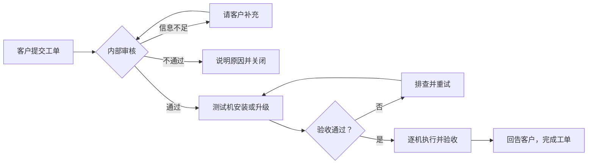

# 软件安装与升级 SOP

版本：2026-10-19
适用范围：`windows-control` 管理后台（数据库模式）、客户工单中心，以及连到后台的 Windows Agent。
本文管什么：普通软件（装在整台机器上、所有用户共用）的申请、审核、安装和升级。
本文不管什么：Agent 和 Codex 自己的发布，见[超级管理员事务 SOP 的 S06](超级管理员事务SOP.md)。

## 先认识几个词

| 词 | 意思 |
|---|---|
| Agent | 装在每台云电脑上的管理程序。它负责下载、校验、安装软件，并把结果报回后台。 |
| 应用目录 | 后台里登记过的安装包清单。每个软件的每个版本是一条记录（目录项）。 |
| 安装任务 | 让某一台机器安装某个版本的一条指令，任务号以 `install-` 开头。 |
| 测试机 | 正式安装前先拿来试装的一台机器。 |
| MSI / EXE | Windows 安装包的两种格式。MSI 的安装方式比较统一；EXE 各厂商不一样。 |
| 静默安装 | 不弹窗、不需要人点"下一步"的安装方式。EXE 要靠厂商规定的参数（如 `/S`、`/quiet`）实现。 |
| SHA-256 | 安装包的"指纹"。指纹一致，说明装的就是审核过的那个包，没被换掉或损坏。 |
| AppLocker | Windows 自带的程序白名单。不在名单里的程序不能运行。 |
| 检测路径 / 检测版本 | Agent 用来判断软件是否已装、装的是哪个版本的依据：看哪个文件、期望什么版本。 |
| `ProductVersion` | Windows 程序文件自带的"产品版本"信息，右键文件看属性也能看到。 |
| OSS | 存放安装包的云存储。 |
| Admin/PostgreSQL | 管理后台和它用的数据库。现在安装任务由它们管理。 |

## 基本原则

- 沿用 [AIC-127](https://linear.app/teenet-dev/issue/AIC-127/梳理并固化直接下发应用安装与管控的标准流程sop) 定下的路线：客户提需求 → 内部人员审核并指定机器 → Agent 直接安装。不使用无影云应用中心。
- 下面四件事是**四个不同的状态**，不能用前一个代替后一个：
  1. 工单已提交；
  2. 安装包已审核；
  3. 安装任务已成功；
  4. 员工实际能用。

流程一览：

## 1. 客户怎么申请

1. 客户联系人登录 **客户工单中心 → 新建工单 → 远程桌面**。
   - 第一次装：选"安装软件"。
   - 已经装了、要换版本：选"更新或卸载软件"，操作选"更新"。
2. 填写内容：
   - 至少勾选一位适用员工，填写软件名称。
   - 最低版本不知道可以留空。
   - 用途、适用范围、希望什么时候处理，填在"补充说明和希望处理时间"里。
   - 普通员工只能选自己；账号管理联系人可以选自己授权范围内的员工。
   - "全选"只选中当前名单里的人，以后新来的员工不会自动包含。
   - 客户不用填机器名、安装参数或下载地址。
3. 在核对页确认操作、软件和适用员工，然后提交，记下工单编号。
4. 之后在 **我的工单** 里看状态、回答实施方的问题、确认最终结果。
5. 不要在工单或回复里写账号密码、API 密钥或许可证密钥。许可证需要交付时，走双方约定的安全渠道。

**注意：**

- 客户提交申请后，系统**不会**自动安装或升级。
- 客户入口能提"卸载"申请，但目前安装任务没有卸载功能。实施方要单独评估厂商提供的卸载方法。删掉目录项不等于卸载。
- 旧版"软件预装清单"只用来收集预装需求，也不会自动创建安装任务。

## 2. 内部受理与审核

1. **核对申请，指定负责人。** 在 **客户工单** 打开申请，核对申请人、软件名称、最低版本、适用员工和希望处理时间，分派负责人。
2. **把员工换算成机器。** 客户选的是员工，安装任务的目标是机器。根据员工和机器的绑定关系，确定实际要装的机器。不能把员工名单直接当成已执行的名单。
3. **审核软件本身。** 核对以下各项：
   - 软件用途、许可；
   - 厂商来源和数字签名；
   - 安装包的 SHA-256；
   - 目标版本；
   - 静默安装方式；
   - 实际安装路径、检测文件、快捷方式；
   - 对 AppLocker 的影响。

   EXE 的静默参数（如 `/S`、`/quiet`）每个厂商不一样，不能看扩展名去猜。只接受公司批准的 MSI，或静默参数已经核实过的 EXE。
4. **给出审核结果。**
   - 信息不全：在工单里公开回复，把状态设为"待客户补充"。
   - 不支持或不批准：告诉客户原因，关闭工单，**不要创建安装任务**。
   - 审核通过：记下批准依据、目标机器、测试机、维护时间和回退安排，再进入安装或升级步骤。
5. 通知员工保存工作，并退出要装或要升级的软件。

## 3. 第一次安装

1. **上传安装包。**
   1. 进入 **软件安装 → 软件目录与安装 → 添加应用**。上传本地的 MSI/EXE，或者填一个可信的下载地址。
   2. 核对系统自动识别出的应用 ID、版本和类型。不对的话在"高级选项"里改。
   3. 填写检测路径，指向真正的可执行文件。
   4. 需要在公共桌面放快捷方式的，填快捷方式名称和目标。
   5. 需要 AppLocker 放行的，只填审核过的、装在整台机器上的目录。
   6. 普通 EXE 填厂商提供的静默参数。
   7. 输入 `INSTALL`，点"上传并审核"。

   微信模板默认的目标路径是 `C:\Program Files\Tencent\Weixin\Weixin.exe`，但仍以目标机器上的实际路径为准。
2. **确认审核完成。** 等上传和审核完成后，在应用目录里核对：这个版本显示"已审核"，类型和 SHA-256 正确。
   - 不同的安装包要用不同的版本号。不要覆盖正在使用的目录版本。
   - **"上传并审核"只是把安装包准备好，不会装到任何机器上。**
3. **在测试机上装。**
   1. 在 **创建安装任务** 里选一台测试机和应用版本，确认后记下 `install-...` 任务号。
   2. 到 **后台任务中心**，筛选"软件安装"，查看任务卡片、详情和机器日志。

   Agent 会在后台下载、校验 SHA-256、安装，然后报告结果。安装过程中，Agent 的心跳（定时报到）和其他控制功能不应该被卡住。
4. **验收后再装其他机器。**
   1. 任务显示"已完成"后，到测试机上核对实际的文件和版本。
   2. 用普通员工身份打开软件，测试核心功能。配置了公共桌面快捷方式的，还要从快捷方式打开一次。
   3. 确认 AppLocker 没有拦截。
   4. 然后按目标机器逐台创建任务、逐台验收。

   目前表单一次只能选一台机器。目录项"已审核"后，系统也不会自动给所有机器装。

## 4. 升级已经装好的软件

1. **准备。**
   - 在测试机上记下：当前文件版本、安装路径、正在运行的进程，以及旧版安装包。
   - 确认厂商安装程序支持直接在旧版本上静默升级，并想好失败后怎么恢复。
   - 安排员工退出软件，约好维护时间。
2. **上传新版。**
   1. 在 **添加应用** 上传新版。**应用 ID** 沿用旧版的，版本号填新的。
   2. "检测类型"设为"文件版本"。
   3. "检测路径"填真正的可执行文件；"检测版本"必须填，不能空。
   4. 在测试机上用下面的命令查看文件版本，确认它能和目录里的**应用版本**对上：

      `(Get-Item -LiteralPath 'C:\实际路径\程序.exe').VersionInfo.ProductVersion`
3. **给测试机创建升级任务。**
   1. 等新版目录项显示"已审核"，并核对 SHA-256。
   2. 给测试机创建新版的安装任务。
   3. 如果这台机器的这个软件已经有一个没完成的任务，先查清原因。确实要取代它，就勾选"替换未完成任务"，旧任务会被取消。
   4. 记下新任务号，在 **后台任务中心** 跟踪。
4. **验收后再升级其他机器。**
   1. 在测试机上再查一次实际的 `ProductVersion`，用普通员工登录后打开软件，测试核心功能。
   2. 通过后，再逐台升级其他机器。
   3. 旧版安装包要一直保留，直到可以回退的时间段结束。

   任务"已完成"不能代替检查实际版本和功能。目前没有一键全部升级，也不会自动卸载旧版。

**升级检测的限制（容易踩坑）：**

- 只有"检测类型"是"文件版本"、并且"检测版本"不为空时，Agent 才会读取可执行文件的 `ProductVersion`。
- Agent 目前**不会**拿读到的版本去比"检测版本"这个字段，而是拿它去比目录里的应用版本。
- 如果用"文件存在"检测，只要文件在，Agent 就认为已经是目标版本。旧版文件还在时，可能会**直接跳过升级**。
- 安装完成后，Agent 不会再读一次实际文件版本来确认升级成功。

所以，如果某个软件的文件版本没法和应用版本对上，要先解决检测方式的问题，再做正式升级。

## 5. 取消、失败和回退

- **取消任务。** 等待执行或正在执行的任务，可以在任务中心取消。取消后要去机器上检查：安装进程、文件，以及旧版还能不能用。取消不代表安装会自动撤回。
- **任务失败。**
  1. 先看 **任务详情 → 查看机器日志** 和安装程序的输出。
  2. 排除原因后，在 **任务详情 → 重试任务** 创建一个新任务，把新任务号关联到工单。

  常见原因和处理：
  - 软件正在运行，或磁盘空间不够：先关掉进程或腾出空间。
  - 报 `standard-user launch check` 路径不存在（意思是"普通用户能否启动"这项检查找不到文件）：核对安装路径、检测路径和快捷方式目标。
  - 被 AppLocker 拦截：核对当前生效的策略和审核过的放行目录。不要为了修一台机器的安装就把全局 AppLocker 关掉。
- **升级失败。** 先确认旧版还能不能打开，再按厂商支持的方法恢复。选旧版并勾"允许降级"，不保证厂商安装程序真能降级；系统也不会自动回滚。
- **删除目录项。** 只会删掉 OSS 里的安装包和清单，**不会卸载机器上的软件，也不会删除历史任务**。有正在进行的任务时不能删除。
- 安装任务现在由 Admin/PostgreSQL 管理。Agent 不会再按旧的 OSS 机器计划，把已经取消的任务重新执行一遍。

## 6. 回告客户和完成标准

1. **把任务关联到工单。** 在工单详情用 **关联任务 → 软件安装**，把每台机器的 `install-...` 任务号关联上。关联本身不会触发安装。
   - 失败或只完成了一部分时，工单保持"处理中"。修好后关联新任务。
   - 不能只凭一个成功的任务就关闭整张工单。
2. **全部验收后回告客户。** 所有目标机器都确认了以下四项：实际版本、普通用户能打开、核心功能正常、AppLocker 不拦截。然后公开回复客户：装了或升了哪个版本、实际覆盖了哪些人、还有什么遗留问题。最后把工单设为"已完成"。
   - 客户可以在工单详情里确认结果；有问题可以回复，工单会重新进入处理。
3. **留存记录。** 要保存：工单编号、批准依据、申请人和执行人、目标员工和机器、新旧版本、安装包 SHA-256、任务号和最终状态、实测结果、异常情况和恢复操作。

**任务显示成功、但实际版本不对的，按失败处理。**

另外两点：

- 目前软件安装没有强制的"两人审批"。"上传并审核"由有权限的内部人员操作。
- Agent 自动做的"标准用户可启动"检查，只确认目标文件存在，并不会真的打开软件。员工那边能不能用，必须由操作人员亲自验收。

## 7. 和早期直接下发流程有什么不同

- **路线没变，管理方式变了。** [AIC-127](https://linear.app/teenet-dev/issue/AIC-127/梳理并固化直接下发应用安装与管控的标准流程sop) 定的是"统一用 Agent 安装，不走阿里云应用中心"，现在仍然这样。但任务的整个过程改由 Admin/PostgreSQL 管理；OSS 只存安装包和清单，不再用旧的 OSS 机器计划来派任务。
- **审核和安装分开。** 新安装包进了目录后，仍要人工选机器、创建任务；客户工单和安装任务也要人工关联。目前没有：客户一申请就自动安装、批量给所有机器安装、单独的"升级"按钮。
- **升级借用安装任务。** "文件存在"检测可能跳过旧版；"允许降级"也不能可靠地防止装错版本。装完后的实际版本、普通用户能否打开、回退结果，都要人工确认。
